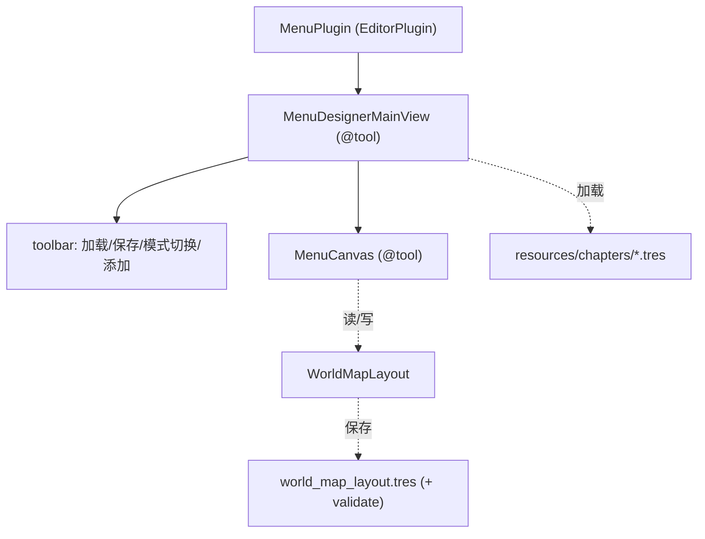

# 设计规范:monk MenuDesigner(菜单坐标可视化编辑器)

> **任务来源**: 两级地图菜单已实现(2026-07-14)+ edges/滚动扩展完成。spec §11 列「菜单坐标可视化编辑」为后续(现手工 .tres)。用户要求实现:新专用插件 + 拖拽式 + 拉连线编辑 next_ids。
> **任务内容**: 新建 MenuDesigner EditorPlugin(平行 LevelDesigner),可视化编辑 WorldMapLayout(岛屿/关卡坐标 + next_ids 分叉),拖拽改位置、拉连线建分叉,保存 .tres + validate 守门。
> **参考文档**:
> - `docs/superpowers/specs/2026-07-14-two-level-level-menu-design.md` — 两级菜单 + WorldMapLayout 数据结构
> - `addons/level_designer/plugin.gd` / `main_view.gd` — LevelDesigner(EditorPlugin main screen 模式参考)
> - `scripts/level/world_map_layout.gd` — WorldMapLayout + validate
> **生成日期**: 2026-07-14

| 字段 | 值 |
|---|---|
| 日期 | 2026-07-14 |
| 状态 | 设计已确认(3 决策),待实施 |
| 产物路径 | 本文件 |
| 产出流程 | brainstorming(3 决策) → spec → plan → 实施 |

## 1. 背景与目标

两级菜单的 `WorldMapLayout` 坐标当前手工写 `.tres`(D8),关卡/章节多时繁琐且不直观。MenuDesigner 提供可视化编辑:拖拽摆位置、拉连线建分叉、即时预览。

**目标**: 可视化编辑 WorldMapLayout,所见即所得,降低布局维护成本。

**非目标**: 编辑关卡内容(那是 LevelDesigner)、运行时菜单逻辑(已完成)。

## 2. 关键决策

| # | 决策点 | 决策 | 理由 | 否决替代 |
|---|---|---|---|---|
| D1 | 架构 | **新 MenuDesigner 插件**(平行 LevelDesigner) | 单一职责:LevelDesigner 编辑关卡内容,MenuDesigner 编辑菜单布局(不同 Resource) | 扩展 LevelDesigner 加菜单模式(混合两套不相关编辑) |
| D2 | 坐标编辑 | **拖拽式**(画布拖节点改 position) | 直观,所见即所得 | SpinBox 数值输入(不直观) |
| D3 | next_ids 编辑 | **拖拽拉连线**(从节点拖到另一节点建 edge) | 直观建分叉,所见即所得 | 列表勾选(简单但不如拉连线直观) |

## 3. 架构(D1)

**插件** `addons/menu_designer/`:
- `plugin.gd` — EditorPlugin(_has_main_screen + main screen "MenuDesigner")
- `main_view.gd` — MenuDesignerMainView(@tool Control):toolbar + canvas + 加载/保存
- `canvas.gd` — MenuCanvas(@tool Control):节点显示 + 连线 + 拖拽 + 拉连线

## 4. 交互(D2 / D3)

MenuCanvas 手势(_gui_input):
- **左键拖节点** = 移动节点(改 entry.position)
- **右键从节点拖到另一节点** = 拉连线(建 next_ids edge;目标=释放点命中的节点)
- **右键拖到空白** = 取消
- 拖拽中画临时连线(从源节点到鼠标),queue_redraw

两级模式(toolbar OptionButton 切换):
- **世界地图模式**:canvas 显示岛屿(ChapterMapEntry),拖岛屿改 position;右键拉岛屿间连线(chapter next_ids)
- **章节N模式**:canvas 显示该章关卡(LevelMapEntry),拖关卡改 position;右键拉关卡间连线(level next_ids)

## 5. 数据流

1. 启动:加载 `world_map_layout.tres`(+ resources/chapters/*.tres 提供 chapter/level id)
2. 编辑:拖拽改 position → entry.position;拉连线 → entry.next_ids += target_id
3. 保存:ResourceSaver + `WorldMapLayout.validate(chapters)` 守门(失败不保存)

## 6. 测试

- `WorldMapLayout.validate` 已有(edges-3),保存前守门
- @tool UI(拖拽/拉连线)不 GUT 测,人工 QA
- 数据操作(增删节点、next_ids 增删)可抽纯函数测(若复杂)

## 7. 验收

- [ ] 编辑器启用 MenuDesigner 插件 → main screen 可见
- [ ] 加载现有 world_map_layout.tres,显示岛屿/关卡
- [ ] 左键拖节点改位置;右键拉连线建分叉;连线按 next_ids 显示
- [ ] 模式切换(世界地图 / 章节)
- [ ] 保存 .tres(validate 通过);重载游戏菜单见新布局

## 8. 后续

- next_ids 删除(右键点连线删除?现仅拖建,删除靠重存)
- undo/redo(参考 LevelDesigner work.push_undo)
- 多 layout 文件支持
