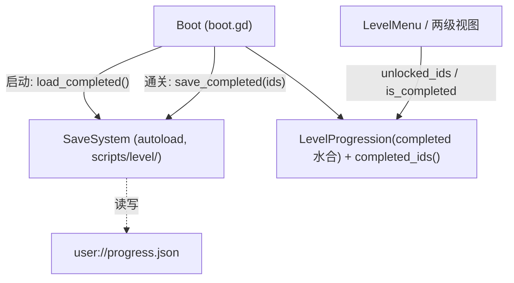

# 设计规范:monk SaveSystem(本地进度持久化)

> **任务来源**: GDD §8.3/§9.2 将「本地进度持久化」列入原型期 scope,但代码尚无任何 `user://` 存档——`boot.gd` 每次启动以空完成列表构建 `LevelProgression`,通关进度重启即丢。用户确认推进该方向。
> **任务内容**: 新建 `SaveSystem` autoload,通关进度存 `user://` JSON 存档,启动恢复;`LevelProgression` 增完成集访问器;boot 接线(水合 + 通关即存)。
> **参考文档**:
> - `docs/project/2026-07-08-gdd-design.md` §8.3/§9.2 —— 持久化范围决策
> - `docs/project/2026-07-08-system-architecture-design.md` §7/§8 —— 「仅进度存档 SaveSystem 用 autoload」、置于 `scripts/level/`
> - `docs/project/2026-07-09-level-data-format-design.md` §8 —— 运行时进度独立存 `user://`,不写入 `.tres`
> **生成日期**: 2026-10-16

| 字段 | 值 |
|---|---|
| 日期 | 2026-10-16 |
| 状态 | 设计已确认(5 决策),待实施 |
| 产物路径 | 本文件 |
| 产出流程 | 现状勘察(测试 151 绿 + 全仓无 user://)→ spec → plan → 实施 |

## 1. 背景与目标

两级菜单 + 图解锁已完成,但 `boot.gd:21` 每次启动 `LevelProgression.new(_chapters, [], ...)`:通关进度仅存内存。目标是补上 GDD 原型期 scope 的最后一块——进度本地持久化,重启不丢。

**目标**: 通关进度持久化到 `user://`,启动水合,所见即上次进度。

**非目标**: 云端同步(GDD 列为未来)、星级/收集物(非 scope)、已解锁章节单独存储(现由关卡解锁派生,无需冗余)。

## 2. 关键决策

| # | 决策点 | 决策 | 理由 | 否决替代 |
|---|---|---|---|---|
| D1 | 架构 | **`SaveSystem` autoload**(架构文档 §7 预定,项目唯一 autoload) | 跨场景全局读进度;文档先例 | boot 内 RefCounted(仅 boot 可见,背离架构文档) |
| D2 | 存档格式 | **JSON `{"version":1,"completed":[...]}`,路径 `user://progress.json`** | 可读、带版本号易迁移;`save_path` 可注入,测试用临时路径 | ConfigFile / 二进制(可读性差)、Resource `.tres`(架构文档明确不写) |
| D3 | 保存时机 | **通关立即保存**(`_on_level_won`) | 崩溃安全;无退出钩子 | 退出时保存(崩溃丢档)、定时保存(无谓 IO) |
| D4 | 容错 | **缺失/损坏/version≠1 → 空列表 + push_warning** | 首次运行、手改坏档安全退化,不崩 | 抛错(玩家无法自救) |
| D5 | 陈旧 id | **存档中未知关卡 id 不过滤** | `LevelProgression` 已容忍(仅影响 `is_completed`,不影响解锁序列);关卡 id 稳定 | 载入时按章节过滤(引入 SaveSystem↔章节耦合) |

## 3. 架构(D1)

- `SaveSystem`(`scripts/level/save_system.gd`,`class_name SaveSystem extends Node`):
  - `save_path: String = "user://progress.json"`(可注入)
  - `load_completed() -> Array[String]`
  - `save_completed(ids: Array) -> bool`
- UI 零改动:菜单读进度仅走 `unlocked_ids() / highlighted_id() / is_completed()`,全部由构造水合的 `completed` 派生。

## 4. 数据流

1. 启动:`boot._ready` → `SaveSystem.load_completed()` → `LevelProgression.new(_chapters, 已存 ids, next_map)` → 菜单显示上次进度
2. 通关:`_on_level_won` → `mark_completed(id)` → `SaveSystem.save_completed(_progression.completed_ids())` → `user://progress.json` 即时落盘
3. 损坏/缺失:`load_completed()` 返回 `[]`,游戏以全新进度开局

## 5. 测试

- `test_save_system.gd`(新):缺失文件→[];save/load 往返;损坏 JSON→[];version≠1→[];空列表往返
- `test_level_progression.gd`(增):`completed_ids()` 返回已标记集合
- `test_boot.gd`(增):预置存档→`_progression` 水合;模拟通关→存档文件写入
- **测试隔离**:boot 测试前把 autoload `save_path` 重定向到 `user://tmp_test_progress.json`,teardown 清理恢复——既不污染真实存档,也不受真实存档影响(确定性)

## 6. 验收

- [ ] 首次启动无存档 → 空进度,正常开局
- [ ] 通关任一关卡 → `user://progress.json` 立即生成,含该关卡 id
- [ ] 重启游戏 → 菜单显示已通关/已解锁状态
- [ ] 手动改坏存档 → 游戏照常启动,进度视为空,不崩溃
- [ ] 全量 GUT 通过(现有 151 + 新增)

## 7. 后续

- 存档迁移(字段变更时 version 升级 + 迁移函数)
- 「重置进度」入口(设置菜单,现无设置 UI)
- 章节解锁独立存储(若未来出现非关卡派生的解锁条件)
